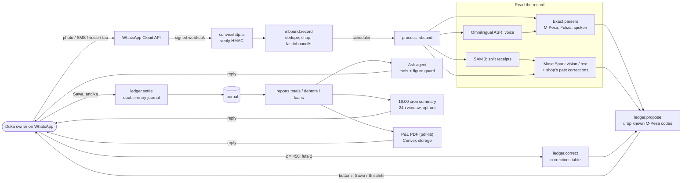

# Duka Books

**A bookkeeper inside WhatsApp for Kenya's small shops (dukas), built on Meta's models.**
Built for the [Meta Global AI Developer Hackathon](https://cerebralvalley.ai/e/meta-ai-developer-hackathon),
indie track, theme "Build for Your World".

The owner keeps doing what they already do: write in an exercise book, keep receipts, forward M-Pesa SMS, send
voice notes. They send those to a WhatsApp number. Duka Books reads them, proposes the entries in Swahili, and
books them only after the owner taps **Sawa, andika** (OK, record it). It can then answer *"nilipata faida ngapi wiki
hii?"* (how much profit did I make this week?), send an evening summary, and produce a monthly profit-and-loss PDF
the owner can take to a SACCO or bank.

## What the owner can send

| Send | What happens |
| --- | --- |
| A photo of the ledger page | Muse Spark reads every money line, then sends a proposal with **Sawa, andika** / **Si sahihi** buttons |
| A photo of several receipts, captioned *risiti* | SAM 3 finds each receipt and sends back the photo with numbered boxes. Each crop is read in parallel, and one proposal groups the lines as "Risiti 1 / 2 / 3" |
| A forwarded M-Pesa or Fuliza SMS | An exact parser reads it, with no model involved: sales, Till and Paybill payments, transaction fees, Fuliza draws, fees and repayments. A transaction code is never booked twice |
| A voice note | It is transcribed and echoed back as *"Nimesikia: …"* (here's what I heard), then handled like text |
| **Si sahihi**, then `2 = 450`, `futa 2`, `2 deni`, `Ghairi` | Fixes one line (2 = 450 sets line 2 to KES 450; futa 2 deletes line 2; 2 deni marks line 2 as credit), deletes a line, or cancels, then re-sends the proposal. Each fix is remembered as an example for that shop |
| *"faida wiki hii?"*, *"nani ananidai?"*, *"deni la Fuliza?"* | Profit this week, who owes me, what I owe on Fuliza. Answers come from tool calls over the ledger; the model never does the arithmetic |
| *ripoti*, *ripoti ya mwezi* / *P&L*, *acha ripoti* | Today's summary now; the monthly P&L PDF as a WhatsApp document; turn off the 19:00 evening summary |

## What was built during the hackathon

Everything in this repository was written during the event (Oct 26 to Nov 4, 2026), starting from an empty repo:
the first commit is Oct 27, and `git log` shows the rest. That covers the WhatsApp webhook and outbox, the M-Pesa and
Fuliza parsers, the extraction prompts and schemas, the confirm/correct loop, the double-entry ledger, the ask agent
and its tools, the summaries and P&L PDF, the receipt cropping and numbering, the audio decoding, the tests and the
eval.

We didn't build these and use them as they are:

- **Meta's models**: Muse Spark (Meta Model API), SAM 3 (`facebook/sam3`, under Meta's SAM licence), Llama 4 open
  weights for the fallback.
- **SAM 3 hosting**: the public Hugging Face Space
  [`prithivMLmods/SAM3-Demo`](https://huggingface.co/spaces/prithivMLmods/SAM3-Demo) (Apache-2.0), called through
  its Gradio API.
- **Platform and libraries**: the WhatsApp Cloud API, Convex, the Vercel AI SDK, Zod, pdf-lib, jpeg-js, fast-png and
  ogg-opus-decoder, each under its own licence.

## Meta AI, and where it runs

| Model | Job | Code | Status (Oct 29) |
| --- | --- | --- | --- |
| **Muse Spark 1.3** (Meta Model API) | Vision extraction of handwritten Swahili/Sheng ledgers and receipts into a Zod schema | `convex/lib/extract.ts` | Built and wired. Waiting on the API key (card); a stub runs meanwhile |
| **Muse Spark** agent with tools | Answers questions with `get_totals(period)`, `get_debtors()`, `get_fuliza_balance()`. A figure guard rejects any number the tools didn't return | `convex/lib/ask.ts` | Covered by mock-model tests. A keyword router gives the same answers until the key arrives |
| **Muse Spark** | Maps free-form corrections ("sukari ilikuwa mia nne hamsini", the sugar was 450) onto a line fix | `convex/lib/corrections.ts` | Covered by mock-model tests. Exact rules handle `2 = 450` today |
| **SAM 3 / 3.1** | Finds every receipt in one photo (text prompt "receipt"), then crops and annotates. `sam-3.1` on the Meta Model API once the key is set | `convex/lib/segment.ts`, `infra/modal_app.py` | **Live** on the dev deployment through a free Hugging Face ZeroGPU Space: 3 real receipts → 3 boxes in about 3 s. Self-host on Modal also written |
| **Muse Spark** audio input | Swahili voice notes: WhatsApp's Opus is decoded to WAV in Convex, `muse-spark-1.2` transcribes (Muse Voice Transcribe has no Swahili) | `convex/lib/transcribe.ts`, `convex/lib/audio.ts` | Built and tested on the wire format; turns on with the key |
| **Omnilingual ASR** (open weights), fallback | The same, self-hosted | `infra/modal_app.py` | Written, untested (needs credits) |
| **Llama 4** (open weights), fallback | The same extraction and agent on an OpenAI-compatible partner host | `convex/lib/ai.ts` (`MODEL_PROVIDER=compat`) | One env change |

**One switch:** setting `MODEL_API_KEY` (Meta, or a compat host for Llama) turns every model path live at once
(`modelsLive()` in `convex/lib/ai.ts`). Without it, the whole loop still runs on the exact parsers and stubs;
stub replies are labelled *Majaribio* (test). `MODEL_STUB=1` forces the stubs during a demo.

## How the ledger stays correct

1. **Signed webhook.** Every POST is checked against Meta's `X-Hub-Signature-256` HMAC with a constant-time compare.
2. **Exactly once.** Inbound messages are deduped by WhatsApp message id, since Meta retries webhooks. M-Pesa transaction
   codes are checked when the proposal is made and again on confirm, because two open proposals can hold the same SMS.
3. **Rules before models.** M-Pesa, Fuliza and simple spoken records ("nimeuza mkate tatu kwa shilingi mia moja
   hamsini", I sold three loaves for 150 shillings) are parsed exactly. The model only sees what the rules can't read.
4. **The model proposes; the owner confirms.** Nothing reaches the books without a tap, and **Si sahihi** opens a
   line-by-line fix instead of a dead end.
5. **Double entry in integer cents.** Each confirmed entry posts balanced debit/credit lines (`convex/lib/posting.ts`)
   across cash, M-Pesa, receivables, payables, Fuliza loans, inventory, sales and expenses. A Fuliza draw is a loan,
   not income, and its access fee is an expense.
6. **Numbers come only from tools.** Every figure in an answer, summary or P&L is a `reports.*` query over the journal.
   If an agent reply contains a number no tool returned, it is replaced with a template.
7. **Sum check.** When a page has a written total ("Jumla"), it is compared with the lines that were read, and the owner
   is warned if they differ.
8. **Untrusted text stays data.** Record text and button payloads never act as instructions: prompts say so,
   and proposal ids are checked against the owning shop.

## Architecture



## Impact

Kenya has about **7.4 million micro, small and medium establishments**: 1.56 million licensed and 5.85 million
unlicensed. They employ about **14.9 million people**, roughly 98% of the jobs the statistics office counted for 2015
(KNBS, [2016 National MSME Survey, Basic Report](https://www.knbs.or.ke/2016-micro-small-and-medium-enterprises-msme-survey-basic-report-2/);
figures as summarised by [Africa Check](https://africacheck.org/fact-checks/reports/fact-checking-president-kenyatta-kenyas-small-businesses-its-data-tower-babel)).
The neighbourhood duka is the most common of them. Most keep their books in an exercise book and their money in
M-Pesa, and both are invisible to a lender. Without records, credit means Fuliza overdrafts and other costly
short-term loans. Duka Books turns the records the owner already makes into a ledger they have confirmed, plus a
dated, bilingual P&L that a SACCO or bank can read. All of it happens in WhatsApp and Swahili, with no app to install,
nothing to type into a form, and no accountant.

## Run it

```bash
pnpm install
cp .env.example .env.local     # see the comments in it
pnpm dev                       # Convex dev deployment
pnpm test                      # unit tests + the full signed-webhook loop (convex-test)
```

WhatsApp setup, click by click: [docs/whatsapp-setup.md](docs/whatsapp-setup.md).

### Without a phone or a model key

`pnpm simulate` plays the shop owner against a deployment. It sends signed webhooks and prints the replies from
the `outbox` table. Simulated shops carry a signed `duka_sim` flag and never trigger a real WhatsApp send, so this
is safe against a live deployment. Use a made-up number:

```bash
export SIM_FROM=254700000901
pnpm simulate "TJK4H7XYZ1 Confirmed.You have received Ksh650.00 from JANE WANJIKU 0712345678 on 27/10/26 at 9:14 AM"
pnpm simulate confirm
pnpm simulate photo && pnpm simulate reject && pnpm simulate "2 = 450" && pnpm simulate confirm
pnpm simulate risiti            # receipt splitting: prints the annotated image link and the grouped proposal
pnpm simulate voice             # voice note through the ASR stub
pnpm simulate "nilipata faida ngapi wiki hii?"
pnpm simulate "ripoti ya mwezi"  # prints the P&L PDF link
```

| Command | What it does |
| --- | --- |
| `pnpm typecheck` / `pnpm test` | Type-check `convex/`; run the tests |
| `pnpm simulate …` | Signed fake webhooks against `CONVEX_SITE_URL` |
| `pnpm smoke:extract <file or text>` | One extraction outside WhatsApp (needs a key) |
| `pnpm eval [name]` | Extraction accuracy over `samples/` against hand-written answer keys (`samples/README.md`) |

## Layout

```
convex/
  http.ts          webhook (verify GET, signed POST) and the privacy page Meta requires
  inbound.ts       dedupe, shop lookup, schedule processing
  process.ts       routing: buttons, corrections, commands, exact parsers, questions, photos, receipts, voice
  ledger.ts        propose, correct, cancel, settle (double entry); refuses a transaction code twice
  reports.ts       totals, debtors, Fuliza owed: every figure the owner is told
  summaries.ts     evening summary (crons.ts, 19:00 Nairobi) and "ripoti"
  pnl.ts           monthly P&L PDF to storage, sent as a WhatsApp document
  lib/ai.ts        model provider + the one live switch
  lib/extract.ts   Muse Spark extraction, few-shot from corrections, sum check
  lib/ask.ts       tool agent, figure guard, keyword router
  lib/segment.ts   SAM 3 receipt boxes, crops, annotated image
  lib/transcribe.ts  voice-note ASR seam
  lib/mpesa.ts, lib/spoken.ts, lib/corrections.ts   exact parsers
infra/modal_app.py  self-hosted SAM 3.1 + Omnilingual ASR (untested; needs credits)
scripts/            simulate, smoke-extract, eval
docs/               plan, roadmap (phase status), WhatsApp setup, submission checklist
```
